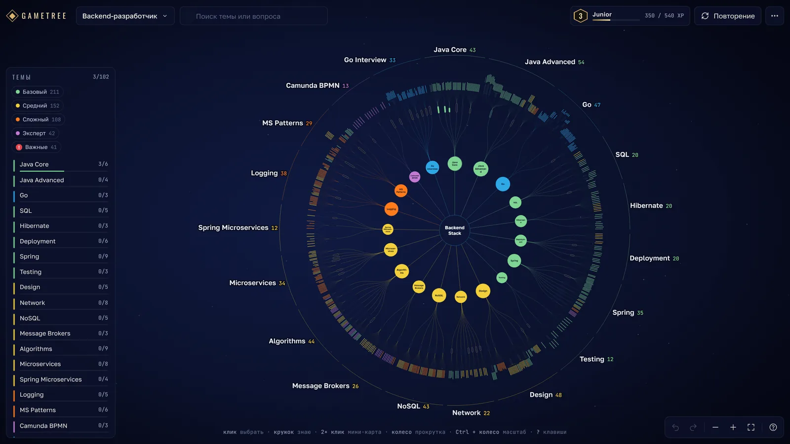
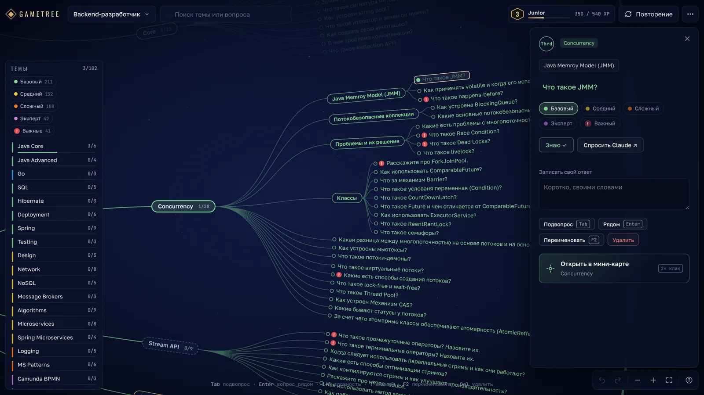
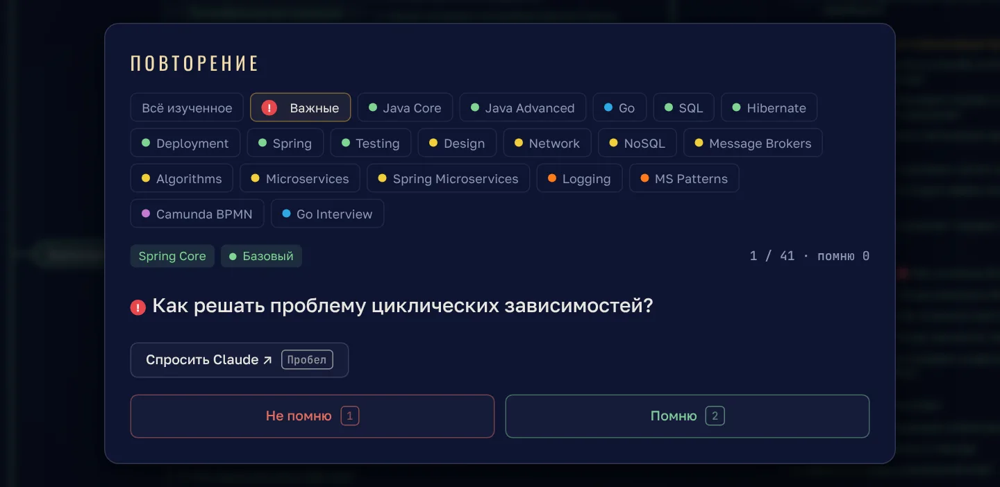

<div align="center">

# ◆ GameTree

**A game-style skill tree for what you actually study.**
One big interactive map: master a skill, unlock the next ones, and come back to review what you learned.

[](https://github.com/Denis-VR/game-tree/actions/workflows/pages.yml)
[](https://github.com/Denis-VR/game-tree/actions/workflows/validate.yml)
[](LICENSE)

[](#build-trees-with-claude)

[**Live demo**](https://denis-vr.github.io/game-tree/) · [Русская версия](README.ru.md) · [Data format](skills/gametree-trees/SKILL.md) · [Contributing](CONTRIBUTING.md)



</div>

## Why

Roadmaps are long lists, and lists are easy to abandon. Skill trees in games make
progress visible: you see what you have, what just opened up, and how far the edge
of the map is. GameTree brings that to learning. It ships with a **Backend developer
map for Java and Go**: 10 branches, 97 skills and 645 self-check questions.

## Features

- **One global map.** All branches share one star map, linked across topics:
  Spring Core needs Java OOP, Go and databases need SQL. The further from the center, the more advanced the topic.
- **Unlocking.** A skill opens when all of its prerequisites are mastered. Skills move through
  *locked → available → learning → mastered*, with XP and levels from Intern to Architect.
- **Self-check questions.** Every skill has interview-style questions. Tick the ones you can answer.
- **Spaced review.** Flashcards from what you have learned. Forgotten cards come back more often,
  and skills you have not revisited for 21 days get a ⟳ badge.
- **Ask Claude.** Any question opens a Claude chat with a ready prompt. On claude.ai the answer streams right into the card.
- **Built-in editor.** Edit skills, questions and links, drag nodes, add branches, Shift+click to connect skills.
- **Projects.** Separate maps with their own progress: System Design, a new language, a specific job offer.
- **Import and export.** Projects and progress as JSON. XMind mind maps convert into a draft project.
- **Zero dependencies.** Vanilla JS and SVG. The build produces one self-contained HTML file.

<table>
<tr>
<td width="60%"></td>
<td width="40%"></td>
</tr>
<tr><td align="center">Skill details: prerequisites, questions, notes</td><td align="center">Review mode</td></tr>
</table>

## Quick start

Requires Node.js 18 or newer. Nothing to install.

```bash
git clone https://github.com/Denis-VR/game-tree.git
cd game-tree
node scripts/build.mjs       # bundles everything into dist/index.html
open dist/index.html         # or just double-click the file
```

The interface is in Russian for now; translations are welcome. Progress is stored in your browser's `localStorage`. Use the **⋯** menu to save progress to a file and move it to another device.

### Deploy your own copy

Fork the repo, then in **Settings → Pages** choose **GitHub Actions** as the source.
Every push to `main` validates the data and publishes the site.

## Build trees with Claude

The repository is also a [Claude Code](https://claude.com/claude-code) plugin with the
`gametree-trees` skill. It teaches Claude the data format and the rules for designing good trees.

```text
/plugin marketplace add Denis-VR/game-tree
/plugin install gametree@gametree
```

Then just ask: *"add a Kotlin branch after Java"*, *"make a System Design map"*,
*"write short answers for the Kafka questions"*. Claude edits the JSON, runs the validator and rebuilds the site.
Without the repository, Claude can produce a project JSON that you load through **Editor → Import**.

## Your own maps

```text
data/projects.json                    order of projects in the menu
data/projects/<id>/project.json       title, center, order of branches
data/projects/<id>/trees/<tree>.json  a branch: skills, prerequisites, questions
```

A skill looks like this:

```json
{
  "id": "go.goroutines",
  "title": "Goroutines and channels",
  "icon": "🌀",
  "description": "Goroutines, buffered and unbuffered channels, select.",
  "requires": ["go.structures", "go.errors"],
  "keystone": true,
  "questions": ["How does select work?", { "q": "What happens when you send to a closed channel?", "a": "panic" }]
}
```

Layout is automatic, so you never write coordinates. The full format is in
[`skills/gametree-trees/SKILL.md`](skills/gametree-trees/SKILL.md).

```bash
node scripts/validate.mjs                                   # ids, references, cycles
python3 scripts/xmind_import.py map.xmind my-map "My map"   # XMind → draft project
```

## Project structure

```text
src/                     app: index.html, styles.css, app.js
scripts/build.mjs        bundles src + data into dist/index.html
scripts/validate.mjs     checks every project in data/projects
scripts/xmind_import.py  converts an XMind file into a draft project
skills/gametree-trees/   Claude skill: how to create and edit trees
.claude-plugin/          Claude Code plugin and marketplace manifests
```

## Contributing

New branches, better questions, fixes and ideas are welcome. Read [CONTRIBUTING.md](CONTRIBUTING.md)
to get started, and please follow the [Code of Conduct](CODE_OF_CONDUCT.md).

## Credits

Inspired by game talent trees and by [SkillWaker](https://skillwaker.com/en) and
[SkillTree OSS](https://skilltreeoss.softexforge.io/). The seed backend map grew out of a personal Java interview mind map.

## License

[MIT](LICENSE) © 2026 Denis Ryabchikov
